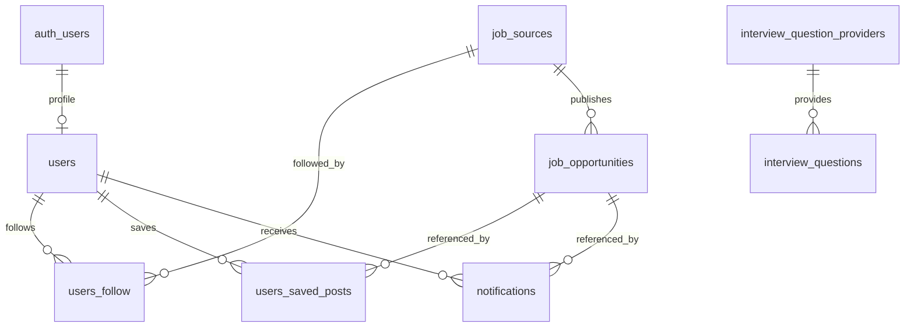

# Cơ sở dữ liệu Job Tracking và kho câu hỏi phỏng vấn

Nguồn yêu cầu: [Requirements_Analysis.md](https://github.com/DungLe939/Docs-HireUS-Tools/blob/ebb898f5f0a24b311e5887ac238b6f2c931848c1/docs/Week02/Submission/Requirements_Analysis.md), revision `ebb898f5f0a24b311e5887ac238b6f2c931848c1`; file không có thay đổi local khi đối chiếu. Các mục áp dụng: FR-JT-01, FR-JT-05, FR-JT-07, BR-JT-02, UC-JT-04. Snapshot `0b9adc8` được review viện dẫn chưa có trong checkout để đối chiếu lại.

- Nền tảng: Supabase / PostgreSQL; schema: `public`.
- Gồm 8 bảng; `users` dùng chung, liên kết Supabase Auth.
- Quy ước: **PK** — khóa chính; **FK** — khóa ngoại; **UQ** — duy nhất; **NN** — không NULL. Các trường không ghi NN và không thuộc PK được phép NULL.
- `TIMESTAMPTZ` lưu thời điểm có múi giờ; múi giờ nghiệp vụ: `Asia/Bangkok`.

## 1. Quan hệ

## 2. Các bảng

### 2.1. `users`

| Thuộc tính | Kiểu dữ liệu | Ràng buộc / Mặc định | Nội dung |
|---|---|---|---|
| `id` | UUID | PK, FK → `auth.users.id` | Mã tài khoản |
| `full_name` | VARCHAR(150) | | Họ tên |
| `job_preferences` | JSONB | CHECK: JSON object | Chuyên môn, cấp độ, địa điểm quan tâm |
| `created_at` | TIMESTAMPTZ | NN, `NOW()` | Thời điểm tạo |

Email và mật khẩu được quản lý trong Supabase Auth.

### 2.2. `job_sources`

Mỗi dòng là một nguồn của nhà tuyển dụng; Các nguồn Facebook, LinkedIn và TopCV được lưu riêng.

| Thuộc tính | Kiểu dữ liệu | Ràng buộc / Mặc định | Nội dung |
|---|---|---|---|
| `id` | UUID | PK, `gen_random_uuid()` | Mã nguồn |
| `name` | VARCHAR(255) | NN | Nhà tuyển dụng / nhà đăng tin |
| `source` | VARCHAR(20) | NN, CHECK | `facebook`, `linkedin`, `TopCV` |
| `url` | TEXT | NN, UQ | URL nguồn đã chuẩn hóa |
| `access_status` | VARCHAR(20) | NN, CHECK, `'unknown'` | `unknown`, `accessible`, `inaccessible` |
| `created_at` | TIMESTAMPTZ | NN, `NOW()` | Thời điểm thêm nguồn |

### 2.3. `job_opportunities`

Mỗi dòng là một bài nguồn, gồm nội dung gốc và dữ liệu trích xuất còn dùng trong schema.

| Thuộc tính | Kiểu dữ liệu | Ràng buộc / Mặc định | Nội dung |
|---|---|---|---|
| `id` | UUID | PK, `gen_random_uuid()` | Mã tin |
| `source_id` | UUID | NN, FK → `job_sources.id` | Nguồn đăng |
| `url` | TEXT | NN, UQ | URL bài gốc đã chuẩn hóa; dùng để đối chiếu tin khi upsert |
| `title` | VARCHAR(500) | | Tiêu đề |
| `raw_content` | TEXT | NN | Nội dung tại thời điểm thu thập |
| `locations` | JSONB | CHECK: JSON array | Danh sách địa điểm |
| `requirements` | TEXT | | Yêu cầu công việc |
| `deadline_at` | TIMESTAMPTZ | | Mốc bắt đầu hết hạn |
| `status` | TEXT | Trường tính khi đọc | `active` nếu thời điểm hiện tại nhỏ hơn hạn; `expired` nếu đã đến hạn hoặc hạn là NULL |
| `published_at` | TIMESTAMPTZ | | Thời điểm đăng |

Tên nhà tuyển dụng lấy từ `job_sources.name` qua `source_id`. PostgREST trả `status` khi trường này được chỉ định trong `select`.

Ràng buộc CHECK:

- `url` phải khác NULL và có ít nhất một ký tự không phải khoảng trắng.

### 2.4. `users_follow`

| Thuộc tính | Kiểu dữ liệu | Ràng buộc / Mặc định | Nội dung |
|---|---|---|---|
| `user_id` | UUID | PK ghép, FK → `users.id` | Người theo dõi |
| `source_id` | UUID | PK ghép, FK → `job_sources.id` | Nguồn theo dõi |
| `status` | VARCHAR(10) | NN, CHECK, `'active'` | `active`, `paused` |
| `followed_at` | TIMESTAMPTZ | NN, `NOW()` | Thời điểm theo dõi |

PK: `(user_id, source_id)`.

### 2.5. `users_saved_posts`

| Thuộc tính | Kiểu dữ liệu | Ràng buộc / Mặc định | Nội dung |
|---|---|---|---|
| `user_id` | UUID | PK ghép, FK → `users.id` | Người thực hiện |
| `job_id` | UUID | PK ghép, FK → `job_opportunities.id` | Tin được thao tác |
| `saved_at` | TIMESTAMPTZ | | Thời điểm lưu, NULL nếu chưa lưu hoặc đã bỏ lưu |

PK: `(user_id, job_id)`.

### 2.6. `notifications`

| Thuộc tính | Kiểu dữ liệu | Ràng buộc / Mặc định | Nội dung |
|---|---|---|---|
| `id` | UUID | PK, `gen_random_uuid()` | Mã thông báo |
| `user_id` | UUID | NN, FK → `users.id` | Người nhận |
| `job_id` | UUID | NN, FK → `job_opportunities.id` | Tin liên quan |
| `created_at` | TIMESTAMPTZ | NN, `NOW()` | Thời điểm thông báo |
| `read_at` | TIMESTAMPTZ | | Thời điểm đọc; NULL nếu chưa đọc |

UQ: `(user_id, job_id)`.

### 2.7. `interview_question_providers`

| Thuộc tính | Kiểu dữ liệu | Ràng buộc / Mặc định | Nội dung |
|---|---|---|---|
| `id` | UUID | PK, `gen_random_uuid()` | Mã nguồn câu hỏi |
| `name` | TEXT | NN | Tên nguồn câu hỏi |
| `url` | TEXT | NN, UQ | Link nguồn câu hỏi |
| `license` | TEXT | | Tên hoặc link giấy phép, NULL nếu chưa xác định |

### 2.8. `interview_questions`

| Thuộc tính | Kiểu dữ liệu | Ràng buộc / Mặc định | Nội dung |
|---|---|---|---|
| `id` | UUID | PK, `gen_random_uuid()` | Mã câu hỏi |
| `source_id` | UUID | NN, FK → `interview_question_providers.id` | Nguồn câu hỏi |
| `content_eng` | TEXT | | Nội dung tiếng Anh |
| `content_vie` | TEXT | | Nội dung tiếng Việt |

Phải có nội dung ở ít nhất một ngôn ngữ. Bản dịch có thể được bổ sung sau.

## 3. Index

### 3.1. Index tự tạo bởi PK / UQ

| Bảng | PK / Unique index |
|---|---|
| `users` | PK `(id)` |
| `job_sources` | PK `(id)`; UQ `(url)` |
| `job_opportunities` | PK `(id)`; UQ `(url)` |
| `users_follow` | PK `(user_id, source_id)` |
| `users_saved_posts` | PK `(user_id, job_id)` |
| `notifications` | PK `(id)`; UQ `(user_id, job_id)` |
| `interview_question_providers` | PK `(id)`; UQ `(url)` |
| `interview_questions` | PK `(id)` |

### 3.2. Index bổ sung

| Tên | Bảng | Cột | Điều kiện |
|---|---|---|---|
| `idx_job_opportunities_source_date` | `job_opportunities` | `(source_id, published_at DESC NULLS LAST, id DESC)` | — |
| `idx_users_follow_source_status` | `users_follow` | `(source_id, status)` | — |
| `idx_users_saved_posts_job` | `users_saved_posts` | `(job_id)` | — |
| `idx_users_saved_posts_saved` | `users_saved_posts` | `(user_id, saved_at DESC)` | `saved_at IS NOT NULL` |
| `idx_notifications_user_date` | `notifications` | `(user_id, created_at DESC)` | — |
| `idx_notifications_job` | `notifications` | `(job_id)` | — |
| `idx_interview_questions_source` | `interview_questions` | `(source_id)` | — |

## 4. Hành vi khóa ngoại

| Khóa ngoại | ON DELETE |
|---|---|
| `users.id` → `auth.users.id` | CASCADE |
| Các `user_id` → `users.id` | CASCADE |
| `job_opportunities.source_id` → `job_sources.id` | RESTRICT |
| `users_follow.source_id` → `job_sources.id` | RESTRICT |
| Các `job_id` → `job_opportunities.id` | RESTRICT |
| `interview_questions.source_id` → `interview_question_providers.id` | RESTRICT |

Các FK dùng hành vi `ON UPDATE NO ACTION` mặc định.

## 5. Trigger và phân quyền trong SQL khởi tạo

| Thành phần | Hành vi |
|---|---|
| `trg_jt_auth_user_created` | AFTER INSERT trên `auth.users`: tạo `public.users` |
| Bổ sung tài khoản cũ | Tạo hồ sơ cho tài khoản Auth đã tồn tại, bỏ qua ID đã có |
| RLS | Bật trên cả 8 bảng |
| `anon` | Không có quyền truy cập 8 bảng |
| `authenticated` | Chỉ SELECT trên 6 bảng Job Tracking theo RLS. Hai bảng kho câu hỏi được truy cập qua backend. |
| `service_role` | Đọc/ghi qua backend; backend kiểm tra quyền người dùng |

Phạm vi SELECT của `authenticated`:

- `users`: chỉ hồ sơ của mình.
- `job_sources`: đọc các nguồn.
- `users_follow`, `users_saved_posts`, `notifications`: chỉ dòng có `user_id = auth.uid()`.
- `job_opportunities`: tin đang lưu hoặc từng có thông báo cho tài khoản. Quyền đọc hai nhóm tin này độc lập với trạng thái theo dõi hiện tại.
- Danh sách tin đã phân phối đầy đủ cần cơ chế lưu lịch sử riêng, xem mục 6.1.
- Hàm trigger tạo hồ sơ dùng `SECURITY DEFINER` với `search_path` rỗng và không cấp quyền gọi trực tiếp cho `PUBLIC`, `anon` hoặc `authenticated`.

## 6. Quy tắc xử lý tại backend

- Bỏ theo dõi bằng cách xóa dòng `users_follow`. Tạm dừng hoặc tiếp tục theo dõi bằng cách đổi `status`.
- Lưu tin bằng cách đặt `saved_at`. Bỏ lưu bằng cách đặt giá trị này thành NULL. Danh sách đã lưu chỉ lấy các dòng có `saved_at IS NOT NULL`.
- Schema này không lưu trạng thái ẩn tin. Nếu vẫn cần chức năng xóa khỏi danh sách cá nhân theo FR-JT-07, cần chốt cách lưu trạng thái đó ở backend.
- Backend sàng lọc tin trước khi phân phối và kiểm tra người dùng còn theo dõi nguồn trước khi tạo thông báo mới. Giữ thông báo cũ và không tạo thông báo mới cho tin đã hết hạn.
- Tính hạn ứng tuyển theo `deadline_at`: hết hạn khi `NOW() >= deadline_at`, còn hạn khi mốc này nằm trong tương lai, và chưa xác định nếu giá trị là NULL.
- Hạn chỉ ghi ngày: chuyển thành 00:00 ngày kế tiếp theo `Asia/Bangkok`, rồi lưu thời điểm tương ứng.
- Trường trích xuất tùy chọn để NULL khi thiếu căn cứ.
- URL được chuẩn hóa trước khi lưu; việc thu thập, AI, cá nhân hóa và tạo thông báo do backend thực hiện.

### 6.1. Tạm dừng và tiếp tục theo dõi

Kiểm tra mong đợi:

- Tin cũ đã được phân phối cho tài khoản vẫn xem được sau khi tạm dừng, kể cả chưa lưu hoặc chưa có thông báo.
- Tin mới sau thời điểm tạm dừng không tự được phân phối cho tài khoản đang tạm dừng.
- Tiếp tục theo dõi có hiệu lực từ lượt kiểm tra kế tiếp.

Policy phải tách quyền đọc tin cũ khỏi điều kiện nhận tin mới. SQL khởi tạo chỉ mở quyền đọc qua tin đang lưu hoặc thông báo. Tin đã phân phối nhưng chưa lưu và chưa có thông báo cần một cơ chế lưu lịch sử phân phối riêng.

## 7. Bảng dùng cho từng màn hình

| Màn hình | Bảng truy vấn |
|---|---|
| Nguồn theo dõi | `users_follow` JOIN `job_sources` |
| Danh sách tin | Truy vấn qua RLS; backend đối chiếu `users.job_preferences`. Lịch sử phân phối đầy đủ chưa có trong schema này. |
| Tin đã lưu | `users_saved_posts` JOIN `job_opportunities` JOIN `job_sources` |
| Thông báo | `notifications` JOIN `job_opportunities` JOIN `job_sources` |
| Chi tiết tin | `job_opportunities` JOIN `job_sources`, kiểm tra quyền truy cập |
