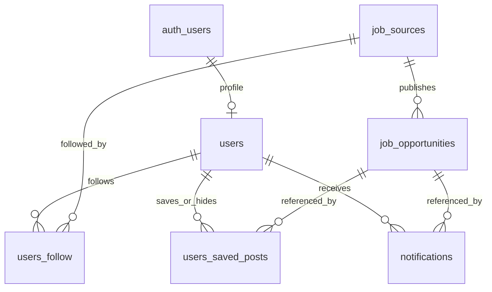

# Cơ sở dữ liệu Job Tracking

- Nền tảng: Supabase / PostgreSQL; schema: `public`.
- Gồm 6 bảng; `users` dùng chung, liên kết Supabase Auth.
- Quy ước: **PK** — khóa chính; **FK** — khóa ngoại; **UQ** — duy nhất; **NN** — không NULL. Các trường không ghi NN và không thuộc PK được phép NULL.
- `TIMESTAMPTZ` lưu thời điểm có múi giờ; múi giờ nghiệp vụ: `Asia/Bangkok`.

## 1. Quan hệ

## 2. Các bảng

### 2.1. `users`

| Thuộc tính | Kiểu dữ liệu | Ràng buộc / Mặc định | Nội dung |
|---|---|---|---|
| `id` | UUID | PK, FK → `auth.users.id` | Mã tài khoản |
| `full_name` | VARCHAR(150) | | Họ tên |
| `job_preferences` | JSONB | CHECK: JSON object | Chuyên môn, cấp độ, địa điểm quan tâm |
| `created_at` | TIMESTAMPTZ | NN, `NOW()` | Thời điểm tạo |

Email và mật khẩu được quản lý trong Supabase Auth.

### 2.2. `job_sources`

Mỗi dòng là một nguồn của nhà tuyển dụng; Facebook và LinkedIn được lưu riêng.

| Thuộc tính | Kiểu dữ liệu | Ràng buộc / Mặc định | Nội dung |
|---|---|---|---|
| `id` | UUID | PK, `gen_random_uuid()` | Mã nguồn |
| `name` | VARCHAR(255) | NN | Nhà tuyển dụng / nhà đăng tin |
| `source` | VARCHAR(20) | NN, CHECK | `facebook`, `linkedin` |
| `url` | TEXT | NN, UQ | URL nguồn đã chuẩn hóa |
| `access_status` | VARCHAR(20) | NN, CHECK, `'unknown'` | `unknown`, `accessible`, `inaccessible` |
| `last_checked_at` | TIMESTAMPTZ | | Lần kiểm tra gần nhất |
| `crawl_interval_minutes` | INTEGER | NN, CHECK > 0, `60` | Chu kỳ thu thập, đơn vị phút |
| `created_at` | TIMESTAMPTZ | NN, `NOW()` | Thời điểm thêm nguồn |

### 2.3. `job_opportunities`

Mỗi dòng là một bài nguồn, gộp nội dung gốc và dữ liệu trích xuất; hỗ trợ bài tuyển nhiều vị trí.

| Thuộc tính | Kiểu dữ liệu | Ràng buộc / Mặc định | Nội dung |
|---|---|---|---|
| `id` | UUID | PK, `gen_random_uuid()` | Mã tin |
| `source_id` | UUID | NN, FK → `job_sources.id` | Nguồn đăng |
| `original_post_id` | VARCHAR(255) | UQ ghép với `source_id` | Mã bài trên nền tảng |
| `original_url` | TEXT | UQ | URL bài gốc đã chuẩn hóa |
| `raw_content` | TEXT | NN | Nội dung tại thời điểm thu thập |
| `title` | VARCHAR(500) | | Tiêu đề |
| `company_name` | VARCHAR(255) | | Doanh nghiệp được tuyển cho |
| `positions` | JSONB | CHECK: JSON array | Danh sách vị trí / chuyên môn |
| `levels` | JSONB | CHECK: JSON array | Danh sách cấp độ |
| `locations` | JSONB | CHECK: JSON array | Danh sách địa điểm |
| `requirements` | TEXT | | Yêu cầu công việc |
| `application_method` | TEXT | | Cách ứng tuyển |
| `classification_status` | VARCHAR(20) | NN, CHECK, `'pending'` | Trạng thái sàng lọc |
| `extraction_evidence` | JSONB | | Căn cứ cho dữ liệu trích xuất |
| `deadline_at` | TIMESTAMPTZ | | Mốc bắt đầu hết hạn |
| `deadline_evidence` | TEXT | | Căn cứ xác định hạn |
| `closed_at` | TIMESTAMPTZ | | Thời điểm xác định đóng tuyển |
| `closure_evidence` | TEXT | | Căn cứ xác định đóng tuyển |
| `original_status` | VARCHAR(20) | NN, CHECK, `'unknown'` | Tình trạng bài gốc |
| `original_checked_at` | TIMESTAMPTZ | | Lần kiểm tra bài gốc gần nhất |
| `published_at` | TIMESTAMPTZ | | Thời điểm đăng |
| `collected_at` | TIMESTAMPTZ | NN, `NOW()` | Thời điểm thu thập |
| `updated_at` | TIMESTAMPTZ | NN, `NOW()` | Thời điểm cập nhật |

Ràng buộc CHECK:

- `classification_status`: `pending`, `eligible`, `ineligible`, `uncertain`, `failed`.
- `original_status`: `unknown`, `available`, `deleted`, `inaccessible`, `login_required`.
- Có ít nhất một trong `original_post_id`, `original_url` khác NULL và không chỉ chứa khoảng trắng.
- Có `deadline_at` phải có `deadline_evidence` không rỗng; có `closed_at` phải có `closure_evidence` không rỗng.

### 2.4. `users_follow`

| Thuộc tính | Kiểu dữ liệu | Ràng buộc / Mặc định | Nội dung |
|---|---|---|---|
| `user_id` | UUID | PK ghép, FK → `users.id` | Người theo dõi |
| `source_id` | UUID | PK ghép, FK → `job_sources.id` | Nguồn theo dõi |
| `status` | VARCHAR(10) | NN, CHECK, `'active'` | `active`, `paused` |
| `followed_at` | TIMESTAMPTZ | NN, `NOW()` | Thời điểm theo dõi |
| `resumed_at` | TIMESTAMPTZ | | Thời điểm tiếp tục theo dõi |

PK: `(user_id, source_id)`.

### 2.5. `users_saved_posts`

| Thuộc tính | Kiểu dữ liệu | Ràng buộc / Mặc định | Nội dung |
|---|---|---|---|
| `user_id` | UUID | PK ghép, FK → `users.id` | Người thực hiện |
| `job_id` | UUID | PK ghép, FK → `job_opportunities.id` | Tin được thao tác |
| `saved_at` | TIMESTAMPTZ | | Thời điểm lưu; NULL nếu chưa lưu / đã bỏ lưu |
| `hidden_at` | TIMESTAMPTZ | | Thời điểm xóa khỏi danh sách cá nhân |

PK: `(user_id, job_id)`.

### 2.6. `notifications`

| Thuộc tính | Kiểu dữ liệu | Ràng buộc / Mặc định | Nội dung |
|---|---|---|---|
| `id` | UUID | PK, `gen_random_uuid()` | Mã thông báo |
| `user_id` | UUID | NN, FK → `users.id` | Người nhận |
| `job_id` | UUID | NN, FK → `job_opportunities.id` | Tin liên quan |
| `created_at` | TIMESTAMPTZ | NN, `NOW()` | Thời điểm thông báo |
| `read_at` | TIMESTAMPTZ | | Thời điểm đọc; NULL nếu chưa đọc |

UQ: `(user_id, job_id)`.

## 3. Index

### 3.1. Index tự tạo bởi PK / UQ

| Bảng | PK / Unique index |
|---|---|
| `users` | PK `(id)` |
| `job_sources` | PK `(id)`; UQ `(url)` |
| `job_opportunities` | PK `(id)`; UQ `(source_id, original_post_id)`; UQ `(original_url)` |
| `users_follow` | PK `(user_id, source_id)` |
| `users_saved_posts` | PK `(user_id, job_id)` |
| `notifications` | PK `(id)`; UQ `(user_id, job_id)` |

### 3.2. Index bổ sung

| Tên | Bảng | Cột | Điều kiện |
|---|---|---|---|
| `idx_job_opportunities_source_date` | `job_opportunities` | `(source_id, collected_at DESC)` | — |
| `idx_job_opportunities_eligible` | `job_opportunities` | `(collected_at DESC)` | `classification_status = 'eligible'` |
| `idx_users_follow_source_status` | `users_follow` | `(source_id, status)` | — |
| `idx_users_saved_posts_job` | `users_saved_posts` | `(job_id)` | — |
| `idx_users_saved_posts_saved` | `users_saved_posts` | `(user_id, saved_at DESC)` | `saved_at IS NOT NULL AND hidden_at IS NULL` |
| `idx_notifications_user_date` | `notifications` | `(user_id, created_at DESC)` | — |
| `idx_notifications_job` | `notifications` | `(job_id)` | — |

## 4. Hành vi khóa ngoại

| Khóa ngoại | ON DELETE |
|---|---|
| `users.id` → `auth.users.id` | CASCADE |
| Các `user_id` → `users.id` | CASCADE |
| `job_opportunities.source_id` → `job_sources.id` | RESTRICT |
| `users_follow.source_id` → `job_sources.id` | RESTRICT |
| Các `job_id` → `job_opportunities.id` | RESTRICT |

Các FK dùng hành vi `ON UPDATE NO ACTION` mặc định.

## 5. Trigger và phân quyền trong SQL

| Thành phần | Hành vi |
|---|---|
| `trg_job_opportunities_updated_at` | BEFORE UPDATE: đặt `updated_at = NOW()` |
| `trg_jt_auth_user_created` | AFTER INSERT trên `auth.users`: tạo `public.users` |
| Bổ sung tài khoản cũ | Tạo hồ sơ cho tài khoản Auth đã tồn tại, bỏ qua ID đã có |
| RLS | Bật trên cả 6 bảng |
| `anon` | Không có quyền truy cập 6 bảng |
| `authenticated` | Chỉ SELECT, chịu giới hạn RLS |
| `service_role` | Đọc/ghi qua backend; backend kiểm tra quyền người dùng |

Chính sách SELECT của `authenticated`:

- `users`: chỉ hồ sơ của mình.
- `job_sources`: đọc các nguồn.
- `users_follow`, `users_saved_posts`, `notifications`: chỉ dòng có `user_id = auth.uid()`.
- `job_opportunities`: tin `eligible` thuộc nguồn đang theo dõi `active`, hoặc tin đã lưu, hoặc tin từng nhận thông báo.
- Hàm trigger tạo hồ sơ dùng `SECURITY DEFINER`, `search_path` rỗng; thu hồi quyền gọi trực tiếp hai hàm trigger khỏi PUBLIC, `anon`, `authenticated`.

## 6. Quy tắc xử lý tại backend

- Bỏ theo dõi: xóa dòng `users_follow`; tạm dừng / tiếp tục: đổi `status`, cập nhật `resumed_at` khi tiếp tục.
- Lưu tin: đặt `saved_at`; bỏ lưu: đặt NULL; xóa khỏi danh sách: đặt `hidden_at`, giữ dòng để không hiện lại.
- Danh sách cá nhân loại tin có `hidden_at`; danh sách đã lưu thêm điều kiện `saved_at IS NOT NULL`.
- Chỉ sàng lọc `eligible` mới được phân phối; kiểm tra lại người dùng đang theo dõi trước khi phân phối / thông báo.
- Không thông báo mới cho tin hết hạn hoặc đã bị người nhận ẩn; giữ thông báo cũ.
- Hết hạn nếu có `closed_at` hoặc `NOW() >= deadline_at`; còn hạn nếu có hạn tương lai và chưa đóng; còn lại là chưa xác định.
- Hạn chỉ ghi ngày: chuyển thành 00:00 ngày kế tiếp theo `Asia/Bangkok`, rồi lưu thời điểm tương ứng.
- Trường trích xuất thiếu căn cứ để NULL; chỉ đặt `original_status = 'deleted'` khi xác định bài đã xóa.
- URL được chuẩn hóa trước khi lưu; việc thu thập, AI, cá nhân hóa và tạo thông báo do backend thực hiện.

## 7. Bảng dùng cho từng màn hình

| Màn hình | Bảng truy vấn |
|---|---|
| Nguồn theo dõi | `users_follow` JOIN `job_sources` |
| Danh sách tin | `job_opportunities` JOIN `users_follow`; đối chiếu `users_saved_posts`, `users.job_preferences` |
| Tin đã lưu | `users_saved_posts` JOIN `job_opportunities` JOIN `job_sources` |
| Thông báo | `notifications` JOIN `job_opportunities` JOIN `job_sources` |
| Chi tiết tin | `job_opportunities` JOIN `job_sources`, kiểm tra quyền truy cập |
